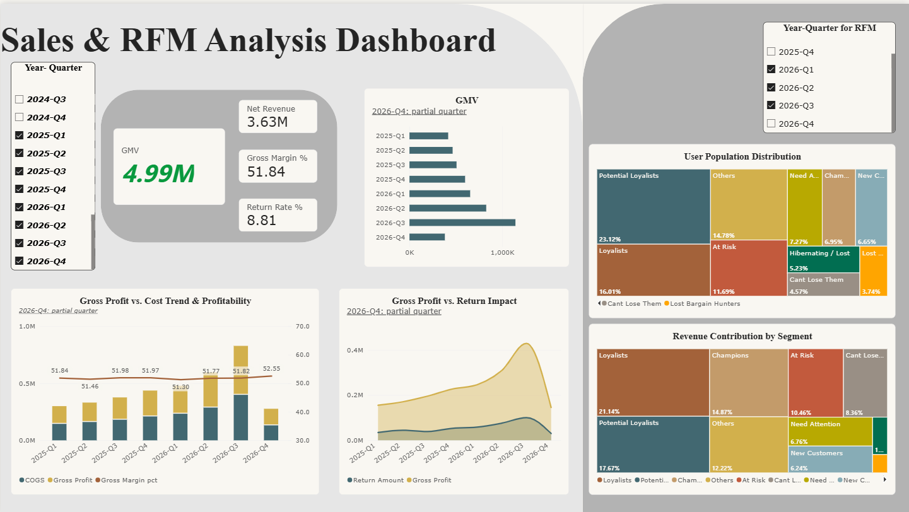

# TheLook E-Commerce: End-to-End Data Pipeline & BI Analytics

A batch ETL pipeline and analytics project built on the TheLook e-commerce dataset. Raw CSV exports (events, orders, order items, inventory, users) are cleaned and modelled with Python and DuckDB into analysis-ready Parquet tables (clean tables → One Big Tables → data marts). The marts feed a sales / RFM dashboard and a few exploratory questions about returns and customer behaviour.

> **Note on the data:** TheLook is a *synthetic* dataset (see [Data & Limitations](#data--limitations)). Findings describe this dataset only, not real customers. The goal of this project is to demonstrate the workflow: data cleaning, modelling, metric design and exploratory analysis.

## Contents

- [Tech stack](#tech-stack)
- [Project structure](#project-structure)
- [Pipeline](#pipeline)
- [Dashboard](#dashboard)
- [Dashboard insights & recommendations](#dashboard-insights--recommendations)
- [Key findings](#key-findings)
- [Data & Limitations](#data--limitations)
- [How to run](#how-to-run)
- [Planned improvements](#planned-improvements)

## Tech stack

- **ETL / modelling:** Python, SQL (DuckDB)
- **Storage:** Parquet
- **EDA & charts:** pandas, matplotlib, seaborn, Jupyter
- **Dashboard:** Power BI

## Project structure

```
.
├── dataset/                       # NOT committed (gitignored)
│   ├── raw/                       # source CSV exports
│   └── processed/                 # clean tables, OBTs, data marts (Parquet)
├── src/
│   ├── __init__.py
│   ├── etl_pipeline.py            # DuckDB ETL: clean -> OBTs -> marts
│   └── visualizations.py          # seaborn / matplotlib chart functions
├── notebook/
│   ├── 01_Behavioral_Insights.ipynb           # returns vs. fulfilment time / session intent
│   └── 02_Data_Quality_Impact_Analysis.ipynb  # effect of the timestamp cleaning on KPIs
├── prototypes/                                # exploratory versions of the cleaning, OBT and mart logic
│   ├── 01_data_cleaning.ipynb
│   ├── 02_build_sales_obt.ipynb
│   └── 03_data_marts_.ipynb
├── dashboards/
│   ├── Sales_RFM_Dashboard.png
│   └── dashboard_demo.mp4
├── requirements.txt
└── README.md
```

`src/etl_pipeline.py` is the maintained version of the pipeline; the notebooks in `prototypes/` are the step-by-step work it was built from.

## Pipeline

`src/etl_pipeline.py` runs three phases in DuckDB.

**Phase 1: clean** (`dataset/raw/*.csv` → `dataset/processed/clean_*.parquet`)

- `events`: anonymous visitors (`user_id` is NULL) are set to `0`; the string `'null'` in `city` becomes `'Unknown'`.
- `inventory_items`: missing product name / brand become `'Unknown'`.
- `users`: missing email, gender and street address become `'Unknown'`; the string `'null'` in `city` becomes `'Unknown'`.
- `orders`, `order_items`: timestamps are cast with `TRY_CAST`; rows whose timestamps are out of order (e.g. shipped before created) are dropped. See [Limitations](#data--limitations).
- Order items removed by the timestamp check are written to `exception_order_items`, so that raw = clean + exception.

**Phase 2: One Big Tables**

- `Frontend_Traffic_OBT`: one row per event, joined with user attributes.
- `Backend_Sales_OBT`: one row per inventory item, joined with order items, orders and users. Unsold items have NULL order fields, so the marts filter on `user_id IS NOT NULL`.

**Phase 3: data marts**

| Mart | Grain | Contents |
|---|---|---|
| `mart_financial_summary` | quarter | GMV, net revenue, COGS, gross profit and margin, AOV, ARPU, return rate |
| `mart_rfm_segmentation` | user × quarter (last 12 months of data) | RFM quintile scores and a rule-based segment |
| `mart_logistics_experience` | order (delivered orders only) | item count, number of distribution centres, hours from order creation to last delivery, return flag |
| `mart_experimentation_base` | identified user | acquisition channel (`traffic_source`), event count, converted flag, total spend. A baseline table for future experiments; the channel is observational, not randomised |
| `mart_impulse_penalty` | session-intent segment | return rate by session-intent segment, for sessions matched to an order (see [Limitations](#data--limitations)) |

**Metric definitions**

| Metric | Definition |
|---|---|
| GMV | Sum of `sale_price` over all items, including returned and cancelled |
| Net revenue | Sum of `sale_price` excluding returned and cancelled items |
| COGS | Cost of the same items counted in net revenue |
| Gross profit / margin | Net revenue − COGS / ÷ net revenue. Returns are already excluded from net revenue, so they do not reduce margin; they are shown separately as *Return Amount* |
| AOV | GMV ÷ distinct orders |
| ARPU | Net revenue ÷ active buyers |
| Return rate (financial mart, dashboard) | Returned items ÷ all items in the period (item level) |
| Return flag (logistics mart) | 1 if the order status is `Returned`, among orders with delivered items (order level) |
| Return rate (impulse mart) | Returned ÷ all matched items, and returned ÷ delivered (Complete + Returned) items (item level) |

## Dashboard



## Dashboard insights & recommendations

The sales charts cover 2025-Q1 to 2026-Q4 (2026-Q4 is a partial quarter) and the RFM charts cover 2026-Q1 to 2026-Q3. The figures come from the cleaned data, which understates GMV by about 20% (see Limitation 3), and the dataset is synthetic, so these are ideas to test, not proven results.

| What the dashboard shows | What I would do | How I would check it |
|---|---|---|
| GMV grew every quarter, from about 417K in 2025-Q1 to about 1.14M in 2026-Q3. The biggest jump was 2026-Q3, up 38% on 2026-Q2. | Find out what drove the 2026-Q3 jump before planning around it. | Split GMV into number of orders, items per order and price (not on the dashboard yet). |
| Gross margin stayed between 51.3% and 52.0% in every full quarter, and the return rate between 8.2% and 9.2%. Returns were about 8–9% of GMV. | Keep both as monitored KPIs. Growth does not seem to be costing margin or returns, so I would not start a margin or returns programme from this dashboard alone. | Keep tracking them each quarter and look into any move outside the current range. |
| Loyalists are 16% of customers but 21% of revenue. Champions and Cant Lose Them are about 12% of customers but 23% of revenue. | Protect these groups first, for example with early access or loyalty perks, and send a win-back offer to Cant Lose Them (high spenders who have not bought recently). | A/B test the offers against a control group and compare repeat purchases and spend. |
| Potential Loyalists are the largest group (about 23% of customers) but spend less per customer (about $62 vs about $80 overall, net revenue per customer over the three quarters). | Try to move them up to Loyalists, for example with a follow-up offer after the first purchase. | A/B test the offer and compare repeat purchases and spend. |
| Hibernating / Lost and Lost Bargain Hunters are about 9% of customers but only 2% of revenue. | Give them low priority for retention spending, at most a cheap automated email. | Compare the cost of the email with the revenue it brings back. |

## Key findings

These are descriptive results on a synthetic dataset. Findings 1, 2 and 4 are simple descriptive summaries; finding 3 shows approximate 95% intervals but no formal hypothesis test or adjustment for other factors.

**1. Sales grew steadily and returns grew in line with sales.** Between Q1 2025 and Q3 2026, quarterly GMV has surged from 417k up to 1.14m (174%) and net revenue from 300k up to 829k (176%) in one and a half years (cleaned data, which understates GMV by about 20%, see Limitation 3; 2026-Q4 is a partial quarter). Gross margin stayed at about 51–52% in every full quarter. The return rate slightly grown about 0.06 percentage points in this period (stayed at about 8-9% in every full quarter), so returns grew in line with sales rather than faster.

**2. No visible link between fulfilment time and returns.** The order-level return rate stays within about 27–30% across fulfilment-time bins from under 24 hours to over 120 hours (`plot_logistics_trend`). In this dataset, slower fulfilment is not associated with more returns. This is a descriptive comparison with no significance test and no adjustment for other factors.

**3. Session intent vs. returns: no difference among delivered items.** Purchase sessions are matched to order items by user and a window from 1 hour before to 4 hours after the purchase event; this matches 118,120 of the 145,577 order items in the cleaned data (81.1%) and 102,847 of 181,466 purchase sessions (56.7%). For the delivered items (the only ones that can be returned), I noticed that there is no large difference in the return rate: 28.8% for Impulse Buyers (n = 30,002), 29.0% for Targeted Searchers (n = 6,872) and 28.3% for Heavy Browsers (n = 2,553) with overlapping approximate 95% intervals. When all items are counted, the rates differ more (10.1%, 8.8% and 7.2%), but only because a smaller share of items reached delivery in the browsing-heavy segments (35.1%, 30.4% and 25.5%), not because delivered items were returned less often. Sessions in the Heavy Browsers segment also contain many more items (2.7 per session vs 1.0 for Impulse Buyers), so the segments largely reflect basket size. This is an observational comparison with no adjustment for product mix, and it does not show that browsing affects returns (see Limitation 5).

**4. Customer segments (RFM).** I scored customers on recency, frequency and spend for each quarter and looked at 2026-Q1 to 2026-Q3. Potential Loyalists are the biggest group (about 23% of customers), but they bring in only about 18% of revenue. Loyalists are 16% of customers and 21% of revenue, so they bring in the most. Champions and Cant Lose Them are only about 12% of customers but 23% of revenue, while Hibernating / Lost and Lost Bargain Hunters are 9% of customers and 2% of revenue. The segment rules are rough (see Limitation 6), so I treat this as a description of the customer base, not as proof that a campaign would work.

## Data & Limitations

### Data

- **Source:** TheLook eCommerce, a fictional online clothing retailer. The data is generated by a simulator and published as the BigQuery public dataset `bigquery-public-data.thelook_ecommerce`.
- **Tables used:** `events`, `inventory_items`, `orders`, `order_items`, `users`, exported as CSV.
- **Not committed:** raw CSVs and Parquet outputs are gitignored because of their size.
- **Export:** CSVs were exported with SQL queries in the BigQuery console.

### Limitations

1. **Synthetic data.** Patterns, including the "no effect" results above, reflect how the data was generated and may not hold in real business data.
2. **Descriptive, not causal.** There is no randomisation, formal hypothesis testing or adjustment for confounders. The 95% intervals shown are approximate and treat items as independent. Group differences should not be read as causal effects. `traffic_source` is an acquisition channel, not an experiment arm, and `mart_experimentation_base` is only a baseline table.
3. **Timestamp cleaning removes 19.8% of order items.** 35,889 of 181,466 order items (145,577 kept) are dropped because a shipped, delivered or returned timestamp is earlier than the item's `created_at`, which would give negative fulfilment times. The rule only hits items that have shipped: about 30% of Shipped, Complete and Returned items are dropped, and no Processing or Cancelled items are, so Processing and Cancelled items rise from 35% to 44% of the cleaned data. Compared with the raw data, the cleaned data understates GMV by 19.7% and net revenue by 22.1%, and the all-items return rate falls from 10.1% to 8.8%. The return rate among delivered items is essentially unchanged (28.8% raw vs 28.7% cleaned) because Complete and Returned items are dropped at almost the same rate (30.2% vs 30.4%). 20,557 orders (16.4%) lose at least one item: 7,852 are removed entirely and 12,705 keep only some of their items, so AOV (86.25 raw vs 73.91 cleaned) and items per order (1.45 vs 1.24) are each understated by about 14%. See `notebook/02_Data_Quality_Impact_Analysis.ipynb`.
4. **Return-rate figures use different denominators.** Only items that reach delivery can be returned, so rates based on delivered items (about 28–29% in the impulse mart, about 28–30% at order level in the logistics mart) are much higher than rates based on all items (about 7–10% in the impulse mart, and 8.2–9.2% per quarter in the financial mart and dashboard, which use the cleaned data; the raw all-items rate is 10.1%, see Limitation 3). See [Metric definitions](#pipeline).
5. **Session-to-order matching is approximate.** The event data has no order key, so purchase sessions are matched to order items by user and a window from 1 hour before to 4 hours after the purchase event, keeping the closest session per item. Most matched orders are created 0 to 4 hours after the purchase event (see the diagnostics at the end of `notebook/01_Behavioral_Insights.ipynb`), so this window covers the main block of time gaps: it matches 118,120 of the 145,577 order items in the cleaned data (81.1%) and 102,847 of 181,466 purchase sessions (56.7%). Sessions whose items were removed by the timestamp cleaning (Limitation 3) cannot be matched. A separate group of about 15,600 items has orders created 20.5 to 24 hours before the purchase event, which looks like a timestamp artifact and is excluded. The segment thresholds (10 / 60 minutes, 6 / 12 page views) are arbitrary.
6. **RFM is heuristic.** Scores are computed per user per quarter, so most users have a single order and frequency scores are weakly informative. "Potential Loyalists" and the final "Others" segment are broad catch-all rules, and "New Customers" is defined by recency plus one order in the quarter, not by first-order date. Cancelled and returned items are excluded from the monetary value. Because scores are computed per quarter, the same customer can fall into different segments in different quarters, so segment counts overlap slightly.
7. **Incomplete latest quarter.** The final quarter in the snapshot is partial.
8. **Anonymous traffic.** In the EDA snapshot, about 46% of events (roughly 1.1M of 2.4M) have no `user_id`. They are mapped to `0` and excluded from user-level marts such as `mart_experimentation_base` (see `prototypes/01_data_cleaning.ipynb`)

## How to run

Requires Python 3.9 or later.

**1. Install dependencies**

```bash
git clone https://github.com/lkean614/thelook-ecommerce-data-pipeline.git
cd thelook-ecommerce-data-pipeline
pip install -r requirements.txt
```

To open the notebooks you also need Jupyter (`pip install jupyter`) or VS Code's notebook support.

**2. Add the data**

Create `dataset/raw/` and `dataset/processed/`, then put these five CSV files in `dataset/raw/`:

```
events.csv   inventory_items.csv   orders.csv   order_items.csv   users.csv
```

**3. Run the ETL pipeline**

The pipeline uses paths relative to `src/`, so run it from there:

```bash
cd src
python etl_pipeline.py
```

This writes the clean tables (plus `exception_order_items`), the two OBTs and the five marts to `dataset/processed/` and prints row counts for each step.

**4. Explore the results**

Open the notebooks with the `notebook/` folder as the working directory (the default in Jupyter and VS Code):

- `notebook/01_Behavioral_Insights.ipynb` reads the marts from `../dataset/processed/` and uses the chart functions in `src/visualizations.py`.
- `notebook/02_Data_Quality_Impact_Analysis.ipynb` reads the raw CSVs from `../dataset/raw/` and the clean tables and marts from `../dataset/processed/`.

Example of using the chart functions:

```python
import os, sys
sys.path.append(os.path.abspath('../src'))

import pandas as pd
import visualizations as vis

df_logistics = pd.read_parquet('../dataset/processed/mart_logistics_experience.parquet')
vis.plot_logistics_trend(df_logistics)
```

The notebooks in `prototypes/` also use `../dataset/...` paths and need the same folder layout.

## Planned improvements

- Compare session-intent segments within order-size groups (for example single-item orders only), since the segments largely reflect basket size.
- Add formal significance tests (with standard errors clustered by user) and adjust for covariates such as product category, order size and customer attributes; extend confidence intervals to the other comparisons.
- Look at multi-warehouse split shipments (`total_dc > 1`) as a follow-up question.
- Make the pipeline runnable from the repository root.
- Keep order items with inconsistent timestamps and flag them instead of dropping them, so only the fulfilment-time analysis excludes them (the current cleaning understates GMV by about 20% and AOV by about 14%).